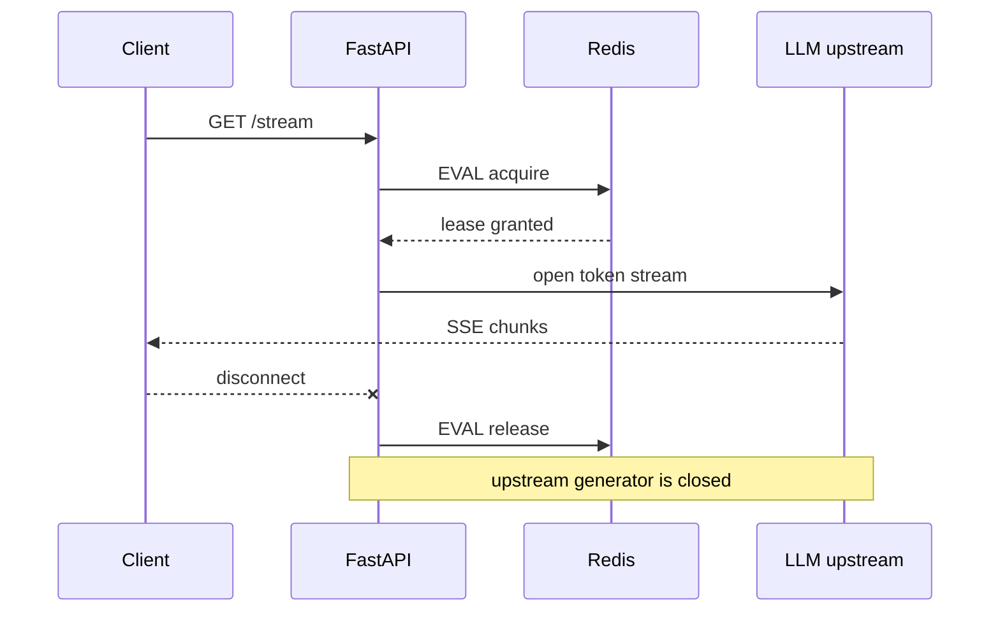

# fastapi-stream-lease

Distributed concurrency leases for SSE, LLM token streams, and WebSocket sessions on
FastAPI and Starlette, backed by atomic Redis Lua scripts.

[Get started](quickstart.md){ .md-button .md-button--primary }
[API reference](api.md){ .md-button }

## Why another limiter?

Request rate limiters answer *how many requests arrived this minute*. Streaming endpoints
need a different question: *how many streams are open right now*.

`fastapi-stream-lease` holds a lease for the lifetime of each stream. A per-user limit, a
global limit, or both can reject the next connection with HTTP 429 before any upstream LLM
tokens are requested. When the client disconnects, the generator finishes, or the lease is
lost, the slot is released immediately. If a worker dies, the lease expires on its own.



## Install

```bash
pip install 'fastapi-stream-lease[fastapi]'
```

The core package only requires `redis`. The `fastapi` extra adds FastAPI for the HTTP
helpers. Python 3.10+ and Redis 5.0+ are supported.

## One-line integration

```python
from fastapi import Depends, FastAPI
from fastapi_stream_lease import LeaseConfig, StreamLeaseManager
import redis.asyncio as redis

app = FastAPI()
client = redis.from_url("redis://localhost:6379", socket_timeout=1.0)
manager = StreamLeaseManager(client, LeaseConfig(max_per_user=2, max_global=500))
manager.register_exception_handlers(app)


async def current_user_id() -> str:
    return "user-123"  # Replace with your verified auth dependency.


@app.get("/stream")
async def stream(user_id: str = Depends(current_user_id)):
    async def events():
        yield "data: hello\n\n"

    return await manager.stream(user_id, events())
```

`manager.stream()` acquires the lease, wraps the generator, renews it in the background,
and releases it on completion, cancellation, error, or client disconnect. A rejected
request raises `StreamLeaseRejected`, which the registered handler maps to HTTP 429 with a
`Retry-After` header.

## What you get

- **Atomic coordination:** acquire, renew, release, and expiration cleanup run in Redis
  Lua scripts. User and global keys share a hash tag for Redis Cluster safety.
- **Disconnect cleanup:** `ProtectedStreamingResponse` closes the upstream iterator when
  the ASGI client disconnects, so abandoned streams stop billing and free their slot.
- **Self-healing:** every lease has a TTL. A crashed worker cannot leave a permanent lock.
- **Backend failure policy:** opt-in worker-local circuit breaker, fail-open fallback, and
  bounded retries during Redis outages.
- **Observability:** Prometheus and OpenTelemetry adapters, plus zero-dependency lifecycle
  hooks that run outside the request path.
- **Cluster and Sentinel coverage:** CI exercises real Redis 5, 7, and 8, a six-node
  Cluster topology, and Sentinel failover.

## Documentation map

- [Quickstart](quickstart.md): run the package locally and test the 429 path.
- [SSE and streaming](guides/sse.md): `StreamingResponse`, `sse-starlette`, heartbeats, and
  disconnect behavior.
- [Production deployment](guides/production.md): multi-worker metrics, Nginx, Kubernetes
  shutdown, Redis sizing, and configuration changes.
- [Observability](guides/observability.md): Prometheus, OpenTelemetry, and lifecycle hooks.
- [Failure model](guides/failure-model.md): what survives crashes, failovers, and Redis
  outages.
- [API reference](api.md): public classes, exceptions, and signatures.
- [Changelog](changelog.md): release notes.
- [Contributing](contributing.md): local checks and pull request expectations.

The repository [README](https://github.com/agustin18/fastapi-stream-lease/blob/main/README.md)
contains the full operational reference, including the detailed failure matrix and
benchmark commands.
